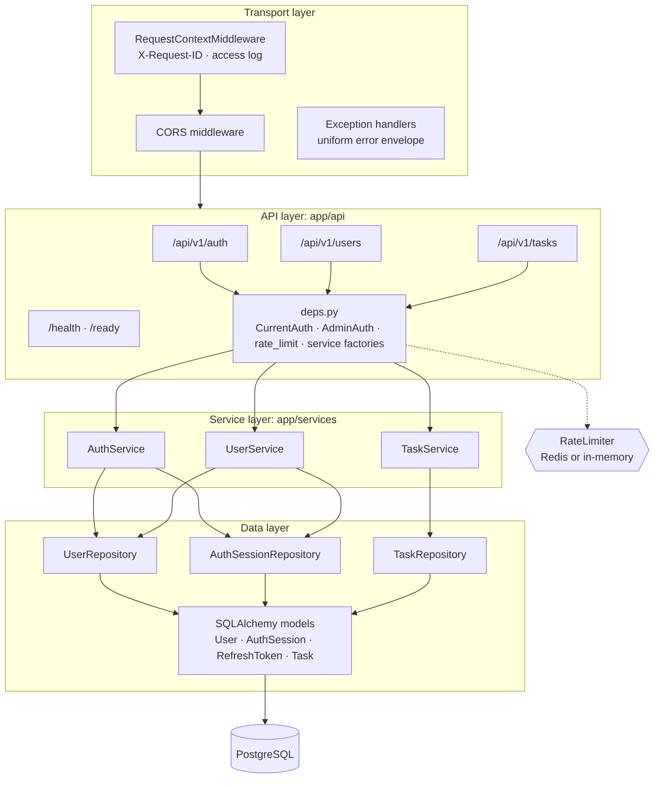
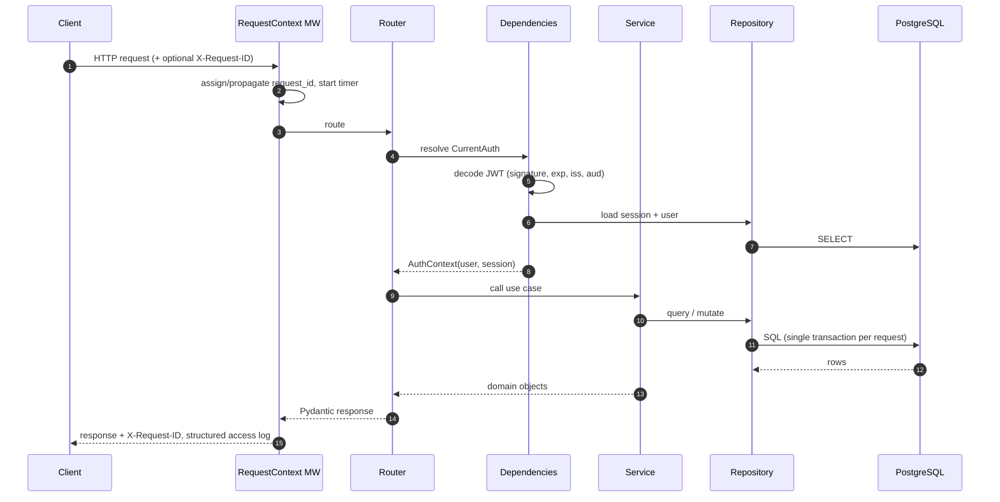
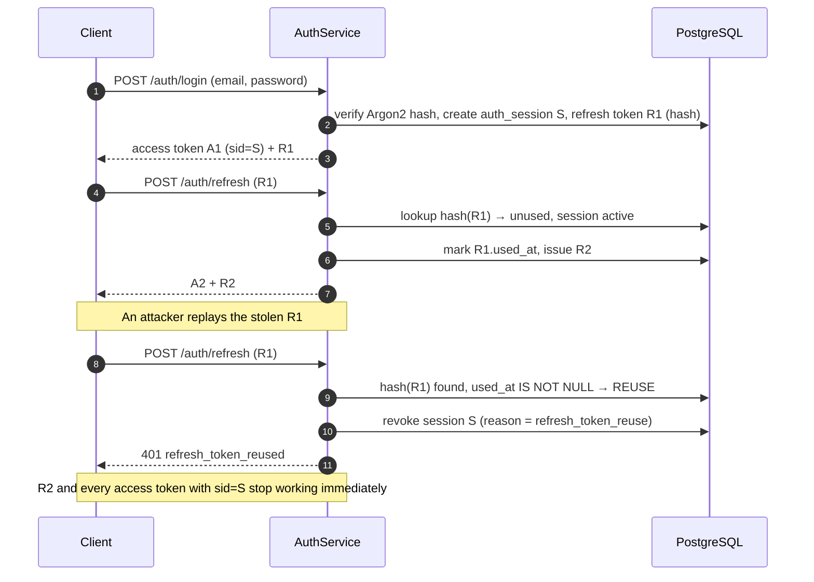
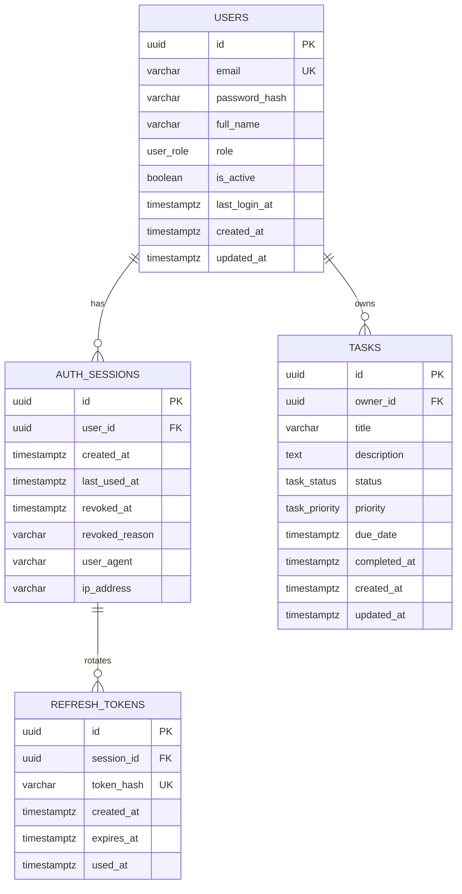

# TaskForge API: Architecture

This document explains how TaskForge is structured, how a request flows through the system, and why the key design decisions were made.

---

## 1. Layered architecture



| Layer | Location | Responsibility | Must **not** |
|---|---|---|---|
| Routers | `app/api` | HTTP concerns: paths, status codes, query parsing, response models | contain business rules or SQL |
| Dependencies | `app/api/deps.py` | Resolve the authenticated user/session, enforce admin role, apply rate limits, build services per request | hold state |
| Services | `app/services` | Business rules: token rotation, ownership checks, password changes, `completed_at` handling | know about HTTP |
| Repositories | `app/repositories` | Queries, filtering, sorting, pagination, persistence | make authorization decisions |
| Models / Schemas | `app/models`, `app/schemas` | Persistence mapping / validated API contracts | leak into each other: ORM objects are converted to schemas at the edge |
| Core | `app/core` | Settings, security primitives, logging, rate limiting, exceptions | depend on upper layers |

Services raise domain exceptions (`AppError` subclasses, e.g. `AuthenticationError`, `NotFoundError`). A single exception handler converts them to the error envelope, so every endpoint fails the same way.

---

## 2. Request lifecycle



- **One database session per request**, rolled back automatically if the request fails.
- The request ID is attached to every log line and to the error envelope, so a client error report can be traced straight to the server logs.

---

## 3. Authentication & token design

TaskForge uses a **hybrid token model**:

| Token | Format | Lifetime | Stored server-side |
|---|---|---|---|
| Access token | Signed JWT (`sub`, `sid`, `role`, `iss`, `aud`, `exp`) | 15 min (default) | No, but its session (`sid`) is checked on every request |
| Refresh token | Opaque random string | 14 days (default) | Yes, **SHA-256 hash only** |

Each login creates an **auth session** (`auth_sessions`). Each session owns a chain of refresh tokens (`refresh_tokens`).

### Refresh-token rotation with reuse detection



- **Logout** revokes the current session. `?all_sessions=true` revokes every session for the user.
- Because access tokens carry `sid` and the session is checked on each request, revocation takes effect **immediately**, without a token denylist.
- Deactivating a user (admin) revokes all of their sessions and blocks login, refresh and access-token use (`403 account_inactive`).
- Changing the password revokes every other session of the user; the session that made the change stays signed in.

### Password storage

`argon2-cffi`'s `PasswordHasher` (Argon2id) hashes passwords. If the parameters are upgraded, hashes are transparently rehashed on the next successful login. A password change requires the current password.

---

## 4. Authorization model

| Role | Tasks | Users |
|---|---|---|
| `user` | CRUD on **own** tasks only | Read/update own profile |
| `admin` | Read all tasks, filter by `owner_id` | List/search users, activate/deactivate, change role |

Ownership is enforced in the **service layer** for every task operation: list queries are scoped with `WHERE owner_id = :current_user` for non-admins (a non-admin passing someone else's `owner_id` gets `403`), and single-task reads, updates and deletes load the row by id and reject it unless the caller owns it or is an admin. A request for another user's task returns `404 Not Found` (code `task_not_found`), not `403`, so the API never confirms that someone else's task exists.

---

## 5. Data model



**Indexing strategy.** Every task query is scoped by `owner_id`, so the indexes are composite with `owner_id` first: `(owner_id, status)`, `(owner_id, priority)`, `(owner_id, due_date)`, `(owner_id, created_at)`. Sessions are indexed on `(user_id, revoked_at)` for "revoke all" and active-session lookups.

**Timestamps.** `created_at` / `updated_at` default to `clock_timestamp()` (not `now()`), so rows created inside one transaction still get distinct, correctly ordered timestamps; `updated_at` is bumped by the ORM on every update.

**Integrity.** PostgreSQL enums for role, status and priority. `ON DELETE CASCADE` from users to sessions, tokens and tasks. A `CHECK (char_length(title) > 0)` constraint. A unique email. A unique refresh-token hash.

The full DDL is in [database_schema.sql](database_schema.sql). Migrations live in `alembic/versions`.

---

## 6. Querying: pagination, filtering, sorting, search

- **Offset pagination**: `page` (≥ 1) and `page_size` (1–100). The response carries `meta.total` and `meta.pages`.
- **Filters**: repeatable `status` and `priority`, `due_before` / `due_after` (timezone-aware, range validated), `owner_id` (admin only).
- **Search**: `q` performs a case-insensitive match on title and description.
- **Sorting**: `sort=-priority,due_date`. Only whitelisted fields are accepted (`created_at`, `updated_at`, `due_date`, `priority`, `status`, `title`). A stable tiebreaker on `id` keeps pagination deterministic.

The page query and the `COUNT` query are built from the same list of conditions, so the filters can't diverge between the two. `LIKE` wildcards in `q` are escaped.

---

## 7. Error handling

Every non-2xx response uses one envelope:

```json
{ "error": { "code": "task_not_found", "message": "Task not found", "details": null, "request_id": "…" } }
```

| Source | Status | `code` examples |
|---|---|---|
| Pydantic / query validation | 422 | `validation_error` |
| Authentication | 401 | `not_authenticated`, `invalid_credentials`, `invalid_token`, `token_expired`, `session_revoked`, `invalid_refresh_token`, `refresh_token_expired`, `refresh_token_reused` (+ `WWW-Authenticate: Bearer`) |
| Authorization | 403 | `permission_denied`, `account_inactive` |
| Business rule | 400 | `invalid_password`, `self_modification` |
| Missing or not-owned resource | 404 | `not_found`, `task_not_found` |
| Duplicate email | 409 | `email_taken` |
| Rate limit | 429 | `rate_limited` (+ `Retry-After`) |
| Database unavailable | 503 | `service_unavailable` (+ `Retry-After`) |
| Unhandled exception | 500 | `internal_error`. The details are logged, never returned |

---

## 8. Rate limiting

`RateLimiter` is a protocol with two implementations:

- **`RedisRateLimiter`**: a fixed-window counter in Redis (`INCR` + `EXPIRE NX` in one pipeline), shared across replicas. If Redis becomes unreachable it **falls back to the in-memory limiter** instead of failing requests.
- **`InMemoryRateLimiter`**: per-process counters with bounded memory and expiry eviction. It's used when `REDIS_URL` is unset.

Limits apply per client IP to `register`, `login` and `refresh`, and are configured through environment variables.

---

## 9. Observability

- **Structured JSON logs** with timestamp, level, logger, message, `request_id`, method, path, status and duration.
- **`X-Request-ID`**: accepted from the client if it matches `^[A-Za-z0-9._-]{1,128}$`, otherwise generated, and echoed on every response.
- **`/health`**: liveness. The process is up. No dependencies are checked.
- **`/ready`**: readiness. Runs `SELECT 1` against PostgreSQL (3 s timeout) and returns `503` if the database is unavailable.
- **Security headers** on every response: `X-Content-Type-Options: nosniff`, `X-Frame-Options: DENY`, `Referrer-Policy: no-referrer`, `Cross-Origin-Opener-Policy: same-origin`.
- Database connectivity errors during a request are mapped to `503 service_unavailable` with `Retry-After`, so clients and load balancers can retry.

---

## 10. Design decisions & trade-offs

| Decision | Why | Trade-off |
|---|---|---|
| Opaque, hashed refresh tokens + session table | Enables rotation, reuse detection and instant revocation. A DB leak doesn't expose usable tokens | One DB lookup per refresh and per authenticated request (session check) |
| Session check on every access token | Logout and revocation take effect immediately | Slightly more DB load than pure stateless JWT. Cacheable later |
| `404` instead of `403` for other users' tasks | Prevents resource enumeration | Slightly less explicit for legitimate debugging |
| Offset pagination | Simple, supports "jump to page", fine for per-user datasets | Cursor pagination would scale better for huge tables (on the roadmap) |
| Redis optional for rate limiting | Zero-dependency local dev, still correct across replicas in production | In-memory limits are per process if Redis is absent |
| PostgreSQL enums | Integrity enforced by the database | Adding a value requires a migration |
| Tests on real PostgreSQL (no SQLite) | Catches dialect-specific bugs (enums, timezones, constraints) | Tests need Postgres. Solved locally with embedded `pgserver`, in CI with a service container |
| Repository layer on top of the ORM | Keeps query logic testable and out of services | More files than an "all-in-the-route" approach |

---

## 11. Scaling notes

- The API is **stateless** apart from PostgreSQL and optional Redis, so it scales horizontally behind a load balancer.
- Connection-pool size, overflow, recycle and statement timeout are configurable per deployment.
- Read-heavy workloads can add a read replica at the repository level.
- Next steps for very large datasets: cursor pagination, PostgreSQL full-text search (GIN index) for `q`, and caching session lookups in Redis.
