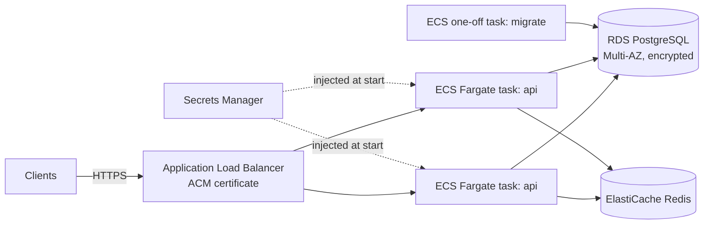

# TaskForge API: Deployment Guide

TaskForge ships as a single stateless container image. It needs:

- **PostgreSQL** (12+; developed and tested on 16) - required.
- **Redis** (7+) - optional; recommended with more than one replica so rate limits are shared.
- A **migration step** (`alembic upgrade head`) that runs before new containers take traffic.
- Secrets supplied through the environment: at minimum `JWT_SECRET_KEY` and `DATABASE_URL`.

Contents:

1. [Option A: Docker Compose on a single VM](#option-a-docker-compose-on-a-single-vm)
2. [Option B: AWS ECS Fargate + RDS (any managed container service)](#option-b-aws-ecs-fargate--rds)
3. [Secrets handling](#secrets-handling)
4. [Production checklist](#production-checklist)
5. [Operations](#operations)

---

## Option A: Docker Compose on a single VM

Good for small teams, staging environments and MVPs.

1. **Provision** a Linux VM (2 vCPU / 2 GB RAM is plenty to start) with Docker Engine and the
   Compose plugin. Open only ports 22 (restricted to your IP) and 80/443.
2. **Get the code and configure it**:

   ```bash
   git clone https://github.com/vks-eng/python-fastapi-backend.git /opt/taskforge
   cd /opt/taskforge
   cp .env.example .env
   chmod 600 .env
   ```

   Edit `.env`:

   ```dotenv
   ENVIRONMENT=production
   DOCS_ENABLED=false
   JWT_SECRET_KEY=<output of: python -c "import secrets; print(secrets.token_urlsafe(64))">
   POSTGRES_PASSWORD=<another long random value>
   CORS_ORIGINS=https://app.example.com
   WEB_CONCURRENCY=2
   # Trust X-Forwarded-For only because the reverse proxy below is the sole way in:
   FORWARDED_ALLOW_IPS=*
   ```

   Compose builds `DATABASE_URL` and `REDIS_URL` for the containers itself.
3. **Start**: `docker compose up -d --build` (or `make up`). Compose starts PostgreSQL and
   Redis, waits for their health checks, runs the one-shot `migrate` service
   (`alembic upgrade head`) and starts the API only if the migration succeeded.
4. **Put TLS in front**. Bind the API to localhost by setting `API_PORT=127.0.0.1:8000` in
   `.env`, then terminate HTTPS in a reverse proxy, for example Caddy:

   ```caddyfile
   api.example.com {
       reverse_proxy 127.0.0.1:8000
   }
   ```

   The proxy must pass `X-Forwarded-For`; uvicorn runs with `--proxy-headers`, and
   `FORWARDED_ALLOW_IPS` decides which proxy addresses are trusted (this is the client IP
   used by the rate limiter).
5. **Create the first admin** (password read from the environment, not the command line):

   ```bash
   docker compose run --rm -e ADMIN_PASSWORD='<strong password>' api \
     python -m app.cli create-admin --email you@example.com
   ```

6. **Upgrade** to a new version:

   ```bash
   git pull
   docker compose up -d --build     # re-runs `migrate`, then recreates `api`
   ```

7. **Back up** PostgreSQL, e.g. a nightly cron job:

   ```bash
   docker compose exec -T db pg_dump -U taskforge -Fc taskforge > /backups/taskforge-$(date +%F).dump
   ```

   Copy dumps off the VM (object storage) and test a restore regularly.

Never run `make seed` / `python -m app.cli seed` here: it creates well-known demo
credentials. (The command refuses to run when `ENVIRONMENT=production`.)

---

## Option B: AWS ECS Fargate + RDS

The same pattern works on Azure Container Apps + Azure Database for PostgreSQL, Google
Cloud Run + Cloud SQL, Fly.io, Render, or Kubernetes.



1. **Image**: build and push to ECR (from CI, after tests pass):

   ```bash
   docker build -t <account>.dkr.ecr.<region>.amazonaws.com/taskforge-api:<git-sha> .
   docker push <account>.dkr.ecr.<region>.amazonaws.com/taskforge-api:<git-sha>
   ```

   Tag with the commit SHA; avoid deploying `latest`.
2. **Network**: a VPC with public subnets for the ALB and private subnets for ECS tasks, RDS
   and ElastiCache. Security groups: ALB → tasks on 8000; tasks → RDS on 5432; tasks →
   Redis on 6379. Nothing else inbound.
3. **Database**: RDS for PostgreSQL 16, Multi-AZ, storage encryption, automated backups and
   point-in-time recovery, `rds.force_ssl=1`. Create a dedicated application role that owns
   the schema (used by migrations) or split migration and runtime roles if you prefer
   least privilege at the database level.
4. **Redis**: ElastiCache for Redis 7 (in-transit encryption on). Set
   `REDIS_URL=rediss://...`. If Redis becomes unreachable the API keeps serving and falls
   back to per-task in-memory rate limits.
5. **Secrets**: store `JWT_SECRET_KEY` and `DATABASE_URL` in AWS Secrets Manager (or SSM
   Parameter Store SecureString) and reference them in the task definition's `secrets`
   block, so they are injected as environment variables at start-up and never appear in the
   image, the task definition in plain text, or CI logs. Grant the task *execution* role
   `secretsmanager:GetSecretValue` on exactly those ARNs.
6. **Task definition** (excerpt):

   ```json
   {
     "family": "taskforge-api",
     "cpu": "512",
     "memory": "1024",
     "networkMode": "awsvpc",
     "requiresCompatibilities": ["FARGATE"],
     "containerDefinitions": [{
       "name": "api",
       "image": "<account>.dkr.ecr.<region>.amazonaws.com/taskforge-api:<git-sha>",
       "portMappings": [{ "containerPort": 8000 }],
       "readonlyRootFilesystem": true,
       "environment": [
         { "name": "ENVIRONMENT", "value": "production" },
         { "name": "DOCS_ENABLED", "value": "false" },
         { "name": "CORS_ORIGINS", "value": "https://app.example.com" },
         { "name": "WEB_CONCURRENCY", "value": "2" },
         { "name": "FORWARDED_ALLOW_IPS", "value": "*" },
         { "name": "DB_POOL_SIZE", "value": "5" },
         { "name": "DB_MAX_OVERFLOW", "value": "5" }
       ],
       "secrets": [
         { "name": "JWT_SECRET_KEY", "valueFrom": "arn:aws:secretsmanager:<region>:<account>:secret:taskforge/jwt" },
         { "name": "DATABASE_URL", "valueFrom": "arn:aws:secretsmanager:<region>:<account>:secret:taskforge/database-url" },
         { "name": "REDIS_URL", "valueFrom": "arn:aws:secretsmanager:<region>:<account>:secret:taskforge/redis-url" }
       ],
       "logConfiguration": {
         "logDriver": "awslogs",
         "options": { "awslogs-group": "/ecs/taskforge-api", "awslogs-region": "<region>", "awslogs-stream-prefix": "api" }
       }
     }]
   }
   ```

   `FORWARDED_ALLOW_IPS=*` is acceptable here only because tasks sit in private subnets and
   receive traffic exclusively from the ALB security group.
7. **Migrations**: before updating the service, run a one-off task with the new image and
   the command override `["alembic", "upgrade", "head"]` (`aws ecs run-task ...`), wait for
   exit code 0, then update the service. Keep migrations backwards-compatible with the
   previous release (expand → migrate → contract) so rolling deploys are safe.
8. **Load balancer health checks**: target group health check path `/ready` (200 = DB
   reachable), or `/health` if you don't want a database blip to drain every task.
9. **Scaling**: target-tracking on CPU (e.g. 60%). Keep
   `replicas x WEB_CONCURRENCY x (DB_POOL_SIZE + DB_MAX_OVERFLOW)` below the RDS
   `max_connections` (or add RDS Proxy / PgBouncer).
10. **Logs**: the app writes JSON to stdout, so CloudWatch Logs Insights can query fields
    directly, e.g. `filter level = "ERROR" | fields request_id, path, exc_info`.

---

## Secrets handling

| Secret | Where it lives | Notes |
|---|---|---|
| `JWT_SECRET_KEY` | Secret manager (Secrets Manager, Key Vault, Secret Manager, Vault) or `.env` with `chmod 600` on a single VM | >= 32 chars, random (the app refuses to start otherwise). Rotating it signs everybody out of their access tokens; refresh tokens remain valid |
| `DATABASE_URL` | Secret manager | Contains the DB password. Use TLS to managed databases |
| `REDIS_URL` | Secret manager if it embeds a password | Use `rediss://` for TLS |
| `POSTGRES_PASSWORD` | `.env` (Compose only) | Never reuse between environments |
| `ADMIN_PASSWORD` | Passed only to the one-off `create-admin` command | Not needed by the running API |

Rules: never bake secrets into the image (`.dockerignore` excludes `.env*`), never commit
`.env`, never pass secrets as CLI arguments, and use GitHub Environments with required
reviewers for any deployment workflow that needs cloud credentials (prefer OIDC federation
over long-lived access keys).

---

## Production checklist

- [ ] `ENVIRONMENT=production` (enables configuration guards: wildcard CORS is rejected).
- [ ] Strong, unique `JWT_SECRET_KEY` from a secret manager.
- [ ] `DOCS_ENABLED=false`, or docs protected at the proxy, if the API is not public.
- [ ] `CORS_ORIGINS` lists only your front-end origins.
- [ ] HTTPS terminated at the load balancer / reverse proxy; HTTP redirected to HTTPS.
- [ ] `FORWARDED_ALLOW_IPS` restricted to your proxy so clients cannot spoof their IP.
- [ ] `REDIS_URL` set when running more than one replica.
- [ ] `alembic upgrade head` runs as a release step before new containers start.
- [ ] Database: encrypted storage, automated backups, PITR, restore tested, TLS enforced.
- [ ] Connection budget: replicas x workers x pool size < database `max_connections`.
- [ ] Health checks wired to `/health` (liveness) and `/ready` (readiness).
- [ ] Logs shipped to a central store and alerting on `level=ERROR` and 5xx rates.
- [ ] First admin created with `create-admin`; demo `seed` data never loaded.
- [ ] CI green (lint, tests, `pip-audit`, Docker build) and Dependabot/CodeQL alerts triaged.
- [ ] Container runs as the built-in non-root user (UID 10001), ideally with a read-only root filesystem.

---

## Operations

| Task | Command |
|---|---|
| Apply migrations | `alembic upgrade head` |
| Roll back one migration | `alembic downgrade -1` (verify the downgrade on a copy first) |
| Show current revision | `alembic current` |
| Create / promote an admin | `ADMIN_PASSWORD=... python -m app.cli create-admin --email ...` |
| Revoke a user's access | `PATCH /api/v1/users/{id}` with `{"is_active": false}` (revokes all sessions) |
| Trace a failing request | Search logs for the `request_id` the client received in `X-Request-ID` / the error body |
